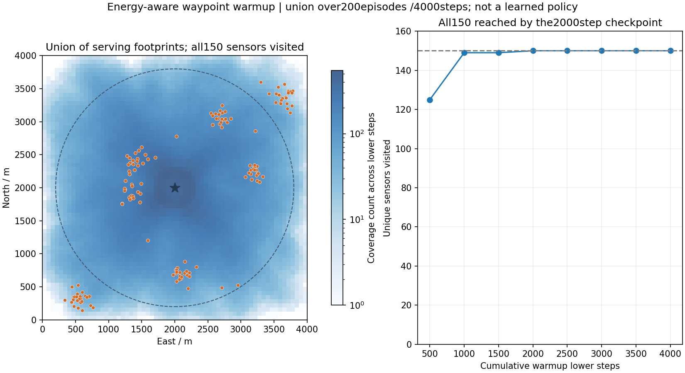

# Lower-only SAC with random20/10step serving groups

This is a separate experiment entry point. No upper actor, critic, charging
requests, slot allocation or fixed Paper1 schedule is used. Existing joint
training and its configuration files are unchanged.

## Task timeline

Each episode starts all six UAVs fully charged at the airship and resets sensor
queues to the configured60second cold start. Randomly sample3or4UAVs uniformly
as the long group; the remaining2or3are short. All six serve steps1..10. After
step10collection, short UAVs pay actual return energy and leave the active set.
They do not collect or charge during steps11..20. Long UAVs serve through20,
then their actual return feasibility and optional return penalty are settled.
The next episode resamples membership. No future-group or countdown feature is
added to SAC observations. SOC remains actual physical SOC, not a time proxy.

Automatic return is an energy settlement and dashed endpoint trace; it does not
create additional service actions or collect data during flight. Return duration
is logged. A short return fits in its remaining10inactive steps under current
geometry/speeds. Long return occurs after the20service-decision window; its
energy still comes from that episode's original battery. No charging energy is
added, and sensor arrivals after the20service-step window are outside this
independent pretraining objective.

## Real energy and remote sensors

Current movement/hover/climb powers, speeds,125Whbattery,4000mmap,150sensors,
173.2mcoverage and0.5packet/sec arrivals are retained. Maximum movement is180m
per lower step. Twentyservice steps consume77.73%to86.93%SOC before return;
thirtysteps require at least116.6%, so30is physically infeasible with this model.

Twentysteps do NOT require staying within1800m. A tested trajectory moves
outward13steps to2340m, collects a sensor at2400m through its coverage radius,
then moves inward7steps to1080m before automatic return. Total SOC use is about
88.9%. A map-corner sensor is also collected and returned safely in a separate
stress test. These are physically executed test trajectories, not trained-policy
results. Hovering or lingering too far out can still cause return failure.

Return feasibility uses actual remaining SOC and the real return model, not a
fixed geometric radius. Each return event logs required/paid SOC, remaining SOC,
return distance/time, margin and the corresponding safe-return distance budget.

## Reward and optimization

Same lower data reward as joint v4:
`(-B_after + .5*B_after*h_top20)/300`, offset0, with actual unique collection.
The existing boundary cost remains. Short group has no return penalty. Long
return failure by default costs500perfailed UAV plus500*failed distance/1800.
`--no-return-penalty` zeros only those two terms; energy accounting, failure
labels, trajectories and20stepend remain unchanged for a fixed action sequence.
There is no upper reward, shared-responsibility allocation or future-backlog tail.
With the configured full initial battery and20stepmaximum, service depletion
cannot occur even at the maximum hover consumption, so the normal task cannot
reduce its negative reward by dying early. Return failures are checked at the
actual retirement horizons, not every10steps for long UAVs.

SAC architecture and observation semantics remain the joint model's: serving
UAV tokens[x/world,y/world,current SOC,id/5], global sensor last-visit vector,
frozen-during-eval RunningMeanStd. Hidden128/4heads/2layers, batch256, replay100k,
gamma .99,lr .0003,automatic alpha starting .05. First10000steps use waypoint
warmup with20%unguarded random actions; guided forecasts use each UAV's10/20step
retirement horizon. After warmup, one SAC update per inserted lower transition
throughout training; no frequency reduction and no MAPPO network is constructed.
Replay next-state masks change from6to3or4 immediately after step10; step20is
terminal with an empty active set. This boundary and exact resume are tested.

## Server commands

After local commit/push:

```bash
cd ~/Code/JV_UAV
git pull --ff-only origin main
CUDA_VISIBLE_DEVICES=1 python3 -u experiments/lower_random_horizon/train.py --device cuda --steps 200000 --output ./runs/lower_random20_10_real_v1
```

Default seed43, map42, dynamics43. Membership has a separate recorded seed45.
200000lowersteps are10000normal20stepepisodes, including10000warmupsteps.
Default evaluation every1000lowersteps across seeds1001/1002/1003, deliberately
including both3and4long UAVs. Full traces/dashboards every5000steps and at the
end; scalar evaluation is logged each time. A quick evaluation during warmup
uses the still-untrained neural actor; SAC update count is printed explicitly.
Checkpoint/plots overwrite every5000/1000steps respectively.

Optional control, same task with long-return reward penalty disabled:

```bash
CUDA_VISIBLE_DEVICES=0 python3 -u experiments/lower_random_horizon/train.py --device cuda --steps 200000 --no-return-penalty --output ./runs/lower_random20_10_no_return_penalty
```

Resume an isolated-lower checkpoint with additional steps (same configuration):

```bash
CUDA_VISIBLE_DEVICES=1 python3 -u experiments/lower_random_horizon/train.py --device cuda --resume ./runs/lower_random20_10_real_v1/checkpoint.pt --steps 100000 --output ./runs/lower_random20_10_real_v1
```

The checkpoint includes SAC/optimizers/alpha, replay, RMS, group membership,
partially completed episode/returns, exploration state and all relevant RNG.
Joint checkpoints use a different format and are not accepted as an isolated
resume. This is a pretraining task; learning it does not itself prove joint
100framecoverage or stability.

## Logs and packaging

- `resolved_config.json`, `provenance/*`: effective task, seeds, source snapshot.
- `train.jsonl`, `live_status.json`: periodic step diagnostics, real SOC and
  actual automatic return events; completed rows are flushed during training.
- `episodes.jsonl.gz`: every episode's return, reward component sums/means,
  sensor/outercoverage, per-UAV collected packets, Top-K-positive step count,
  actual return events/success and exploration statistics.
- `eval.jsonl`, `latest_eval.json`: ongoing frozen-policy evaluation.
- `lower_training_curves.png`, `loss_curves.png`, `evaluation_curves.png`:
  overwritten plots; policy/value losses are on separate panels.
- `training_curves.json`: compact episode plot data. Full evaluation trace has
  all serving endpoints, exact active IDs, coverage/collection, SOC and returns.
- `episodes/episode_*.json.gz`: occasional training traces, every250episodes.

The existing packer supports this output directory, including active training:

```bash
python3 pack_results.py ./runs/lower_random20_10_real_v1
```

No long convergence run was started by the agent. CPU checks cover114regression
checks, CLI smoke/real20step execution, optional penalty control, mask changes,
physical energy/collection and exact partial/reset checkpoint continuation.

## Exploration feasibility audit

With this task's energy-aware waypoint warmup,200episodes/4000steps collectively
visited150/150sensors, including all50outer sensors. The recorded2000stepaudit
checkpoint already had all150. There were5long-return failures out of690long
returns. This is aggregate exploration across episodes, not single-episode full
coverage and not learned-policy convergence. Evidence is in verification/.


